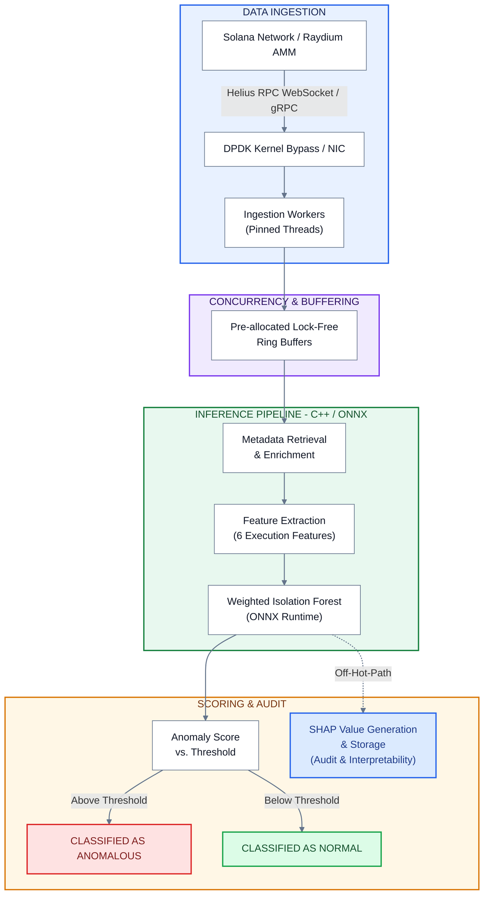

# Solana Pre-Finality Transaction Anomaly Detection

## Executive Summary:

Solana's high transaction throughput creates a need for efficient monitoring of anomalous transaction activity. This system could support several applications within the Solana ecosystem, including network monitoring, providing additional monitoring signals to validators, MEV research, and post-trade analysis.

This proposed algorithm would use a heuristic-guided Isolation Forest to identify trends that deviate from the normal baseline behavior defined by historical activity on the network. The current proof of concept uses six execution-derived features to calculate anomaly scores, while using statistical methods like modified Z-scores to calculate the weights for each heuristic. These weights influence the probability of each feature being selected during tree construction, allowing the model to incorporate feature-level statistical characteristics into its isolation process. The future expansion of this system would focus on building an inference-based evaluation framework to process transactions before block finality, meaning it has to operate within Alpenglow's approximately 150 ms finality target  (now on mainnet-beta).

## File Structure:

The `src` folder houses the code for the project
Inside `src` there are:
- `DataPipeline/`
  - `DataPipeline.py` — Gets real data
  - `SyntheticData.py` — Generates synthetic data using a CTGAN
- `MedianWeights.py` — Calculates the weights that will be applied
- `isoforest.py` — Creates the class structure for a custom isolation forest with heuristic guided splits
- `main.py` — Main pipeline for training the model + export to ONNX

To view dependencies use the `uv.lock`, `pyproject.toml`, and `python-version` files.

To view the architecture and the whitepaper of the project in more depth view: `MEV_Whitepaper(3).pdf`

## Architecture Diagram:

